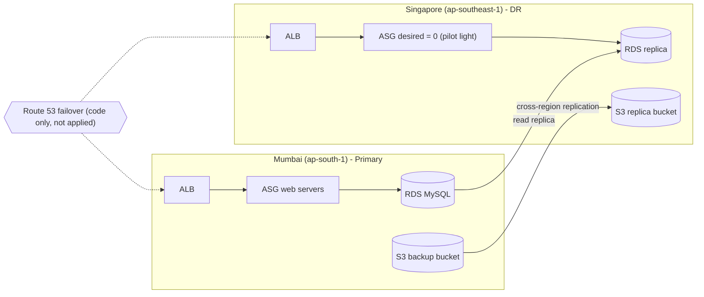
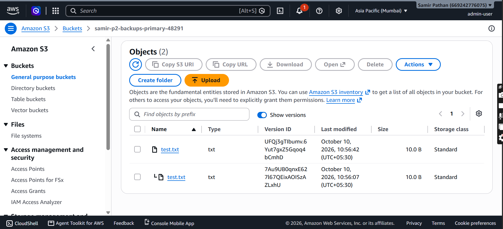
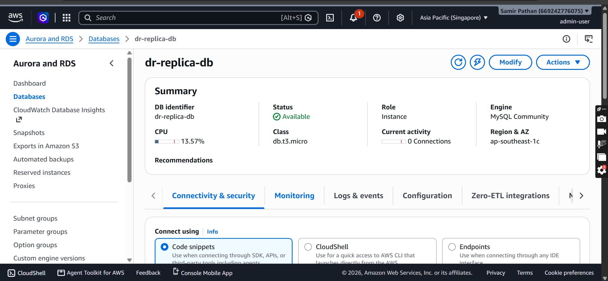
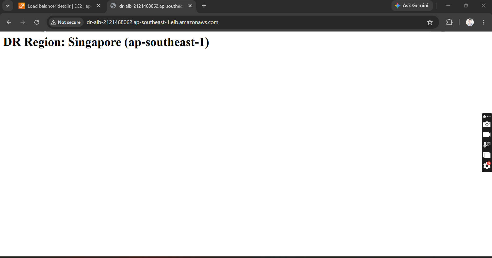
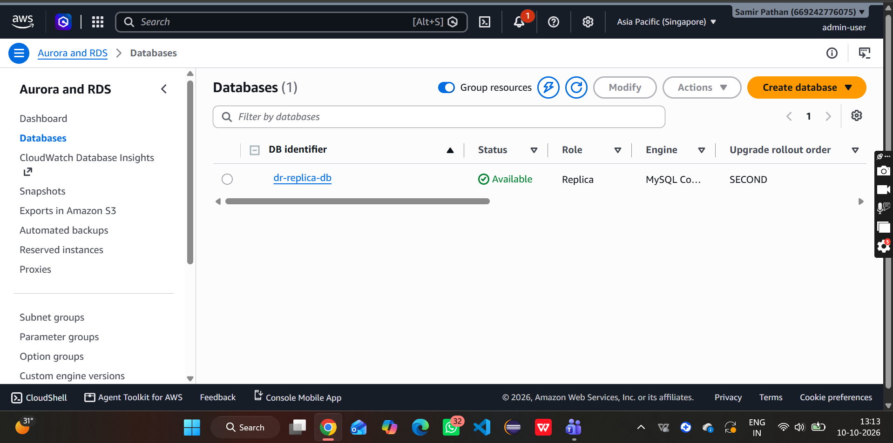
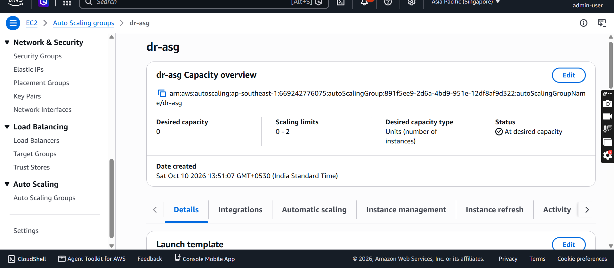
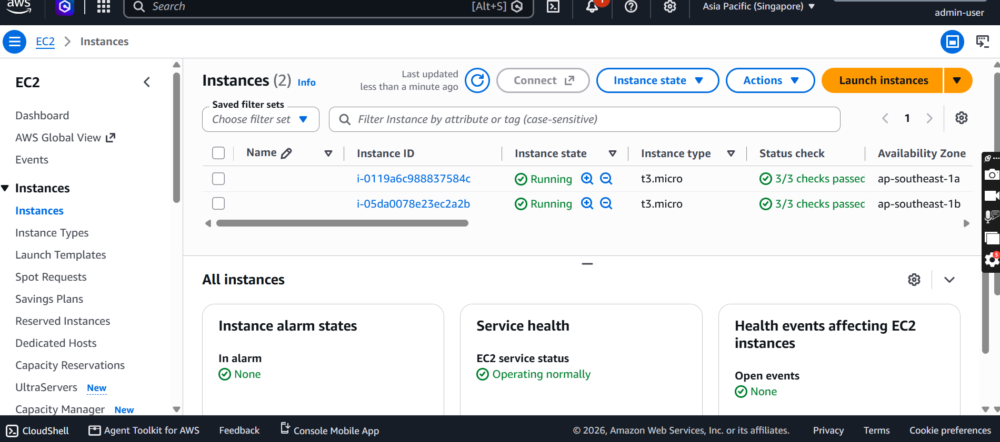
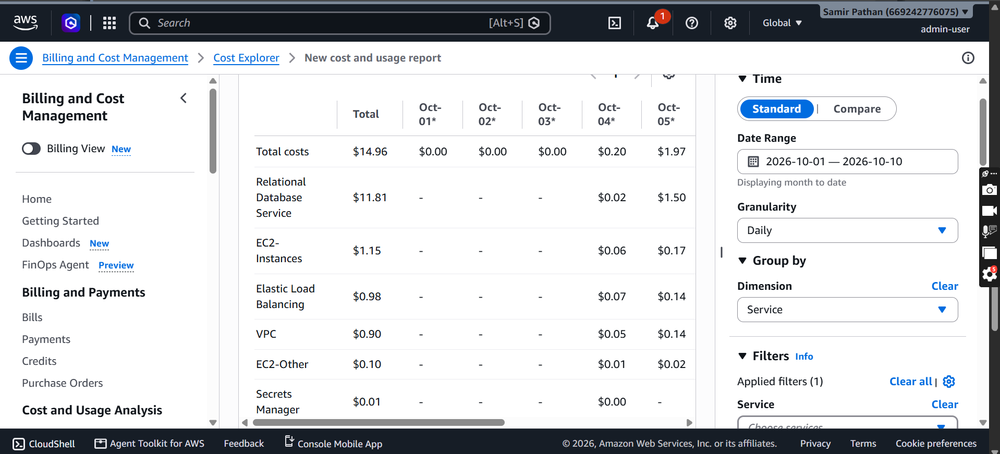
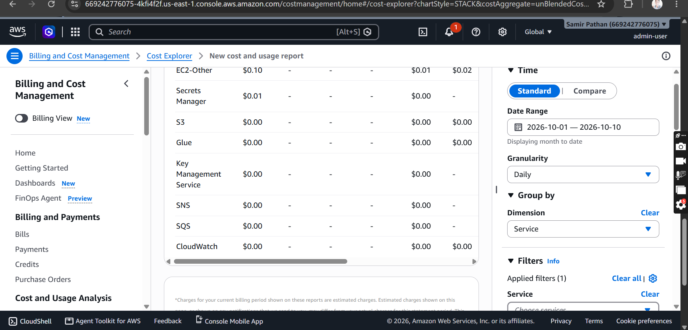

# Project 2: Disaster Recovery and Cost Optimization on AWS

Disaster recovery for the web stack from Project 1. Primary region is **Mumbai (ap-south-1)** and the DR region is **Singapore (ap-southeast-1)**. Everything is built with Terraform, one `.tf` file per phase. Recovery was tested by hand and timed, and all resources were destroyed afterwards.

> Built as a learning project on an AWS account with credits. All resources were torn down after testing.

## Goal

Answer two questions with real numbers instead of theory:

1. If Mumbai goes down, how long until the app is back in Singapore (RTO), and how much data can be lost (RPO)?
2. What does a DR setup cost, and how do the common DR strategies compare?

## Architecture

## What I built

| Phase | What I built | How |
| ----- | ------------ | --- |
| 1 | S3 backup bucket with versioning, tested with two versions of `test.txt` | Terraform |
| 2 | S3 cross-region replication, Mumbai to Singapore | Terraform |
| 3 | RDS cross-region read replica in Singapore, plus a promote test | Terraform |
| 4 | Pilot light in Singapore: VPC, ALB and an Auto Scaling Group with desired capacity 0 | Terraform |
| 5 | Budget, Cost Explorer review and cost comparison | AWS console |

Providers for both regions are configured in `providers.tf`. Each phase has its own `.tf` file in this folder.

Phase 1 proof: two versions of `test.txt` in the Mumbai bucket.

## Results

| Test | Result |
| ---- | ------ |
| S3 replication status | COMPLETED |
| RDS replica lag (idle database) | 0.0 seconds |
| RDS replica promotion to standalone | About 10 minutes |
| Pilot light failover (ASG scale-up until DR page opened) | About 15 minutes |
| **Application RTO** | **About 15 minutes** |
| **RPO** | **Close to 0 seconds on an idle database** (replica lag 0.0 s). Not tested under load, so real lag may be higher. |

Screenshots:

## Failover design

- **Strategy: pilot light.** The VPC, load balancer and database replica already exist in Singapore. Web servers stay off (ASG desired = 0) until a disaster.
- **Failover steps I tested:**
  1. Promote the RDS replica to a standalone database.
  2. Scale the Singapore ASG up from 0.
  3. Open the DR page through the Singapore ALB.

  

  

- **Route 53 failover:** I wrote it as Terraform code with a health check but did **not apply** it, because I do not own a domain. I tested failover manually instead. With a domain, Route 53 would switch traffic automatically.

## Cost optimization

AWS usage cost for Oct 1 to Oct 10 (whole account, so it also includes Project 1 resources):

| Service | Cost |
| ------- | ---- |
| RDS | $11.81 |
| EC2 | $1.15 |
| ELB | $0.98 |
| VPC | $0.90 |
| Other (EC2-Other, Secrets Manager) | $0.11 |
| **Total** | **$14.96** |

This was covered by AWS credits. RDS was the biggest cost, so the main saving is to keep the replica only for as long as the test needs it.

Cost Explorer showed $0.00 at first because billing data arrives with a delay. The real numbers appeared later.

### DR strategy comparison

| Strategy | Idea | Cost | RTO |
| -------- | ---- | ---- | --- |
| Backup and restore | Only backups in the DR region | Low | Hours |
| **Pilot light (built)** | Core pieces on, servers off | Low to medium | About 15 min (measured) |
| Warm standby | Small working copy always running | Medium to high | Minutes |
| Active-active | Full copy serving traffic in both regions | High | Near zero |

Cost and RTO for the other strategies are estimates. Only the pilot light RTO was measured.

## Problems I hit and how I fixed them

**S3 buckets would not destroy**
- Cause: the buckets were versioned and still held objects.
- Fix: set `force_destroy = true` on the buckets, then ran `terraform destroy`.
- Learning: Terraform only deletes a versioned, non-empty bucket when this flag is set.

**Leftover manual snapshots after destroy**
- Cause: I created two RDS snapshots by hand, so Terraform did not know about them.
- Fix: deleted them from the console.
- Learning: Terraform destroys only what it manages. Always do a manual leftover check afterwards.

**Destroying RDS separately**
- I removed both RDS instances first with `terraform destroy -target`, because they were the main cost driver, and destroyed the rest afterwards.

## Limitations and trade-offs

- Route 53 failover is code only (no domain).
- Failover is manual, not automatic.
- RPO and replica lag were measured on an idle database, not under load.
- Only one DR region and one pilot light setup were tested.
- The cost comparison for other strategies uses estimates, not measured spend.

## Cleanup

- `terraform destroy` run for all phases.
- Manual snapshots deleted.
- Leftover check done in Mumbai and Singapore.

## What this project covers

S3 versioning and cross-region replication, RDS cross-region replica and promotion, pilot light DR, RTO and RPO measurement, Route 53 failover design, multi-region Terraform providers, cost monitoring with Budgets and Cost Explorer, and cleanup discipline.