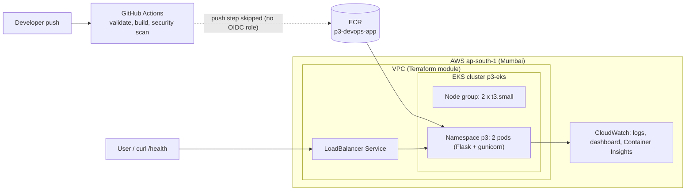
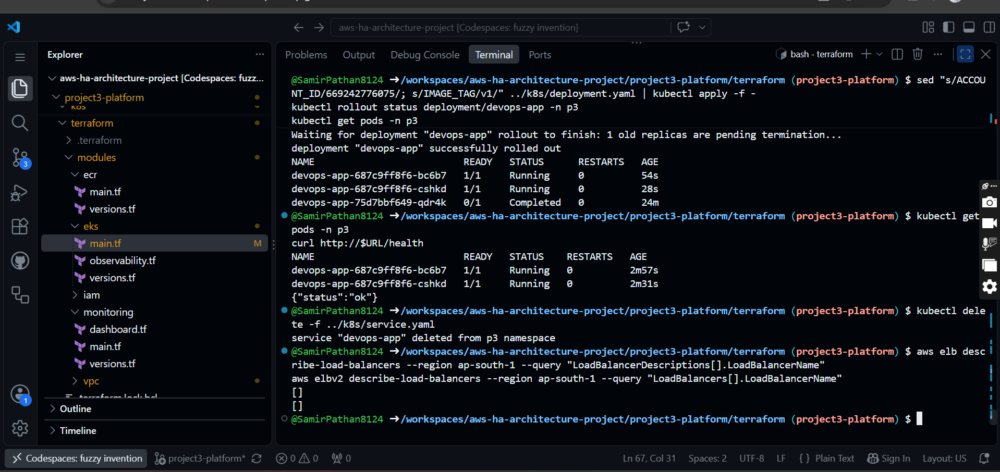
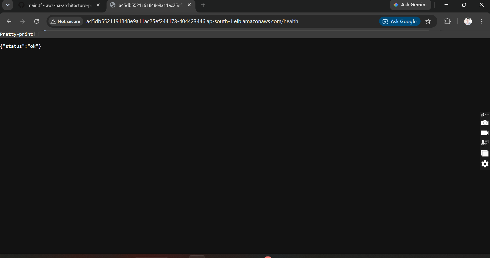
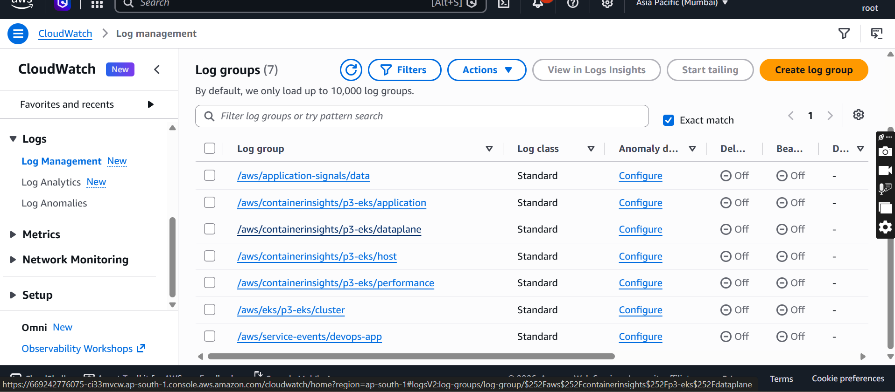
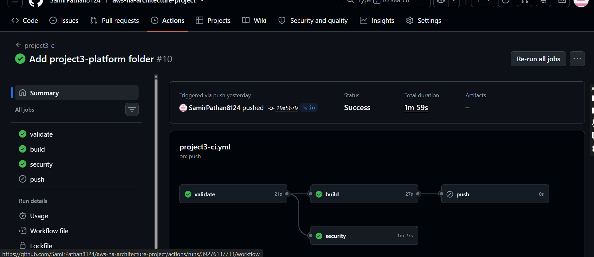

# Project 3: Secure DevOps Platform on AWS (Terraform, Docker, EKS, CI/CD)

A containerized Flask app deployed on Amazon EKS. The infrastructure is written as Terraform modules, the build runs through a GitHub Actions pipeline with security scanning, and the cluster is monitored with CloudWatch. I deployed it live once, tested it, recorded the results and destroyed everything the same day.

> **Scope note:** the EKS platform runs in one region, **Mumbai (ap-south-1)**. Disaster recovery in a second region (Singapore) is covered in [Project 2](../project2-dr/README.md). The projects in this repo are separate builds, not one connected system.

## Goal

Show the delivery side of cloud work end to end: build an image, run it through a pipeline, run it on Kubernetes, scan it for problems and watch it with logs and a dashboard, all defined as code.

## Architecture



## What I built

| Phase | What I built |
| ----- | ------------ |
| 1 | Repo structure, a small Flask app with a `/health` endpoint, and a Dockerfile (gunicorn, non-root user), tested locally |
| 2 | Terraform modules: `vpc`, `ecr`, `iam`, `eks`, `monitoring` (plan only until the live run) |
| 3 | Kubernetes manifests: namespace, deployment, service |
| 4 | GitHub Actions workflow `project3-ci.yml`: validate, build, push |
| 5 | Security: NetworkPolicy, `.dockerignore`, Trivy and Checkov scans in CI |
| 6 | Monitoring: CloudWatch dashboard, EKS control plane logs, CloudWatch observability add-on |
| 7 | One live deployment with screen recording, then full destroy |
| 8 | Documentation, README and cost table |

Folder layout:

```
project3-platform/
  app/        Flask app, requirements.txt, Dockerfile
  terraform/  modules: vpc, ecr, iam, eks, monitoring
  k8s/        namespace, deployment, service, network policy
  docs/       notes
  screenshots/
```

## Results

| Check | Result |
| ----- | ------ |
| `terraform plan` before the live run | 44 resources to add |
| EKS cluster `p3-eks` | Applied in ap-south-1, 2 nodes Ready (t3.small) |
| App pods in namespace `p3` | 2 pods Running |
| `curl /health` through the LoadBalancer | `{"status":"ok"}` |
| Pod restarts after the probe fix | 0 |
| CI run (validate, build, security) | Green |
| `terraform destroy` | 44 resources destroyed |






## CI/CD and security

- The workflow runs on every push: Terraform validate, Docker build, then a security job.
- **Trivy** scans the container image and **Checkov** scans the Terraform code.
- The **push to ECR step is skipped** in the pipeline, because the GitHub OIDC role for AWS was never created. For the live run I pushed the image `p3-devops-app:v1` to ECR manually.
- The image runs as a non-root user, and a Kubernetes **NetworkPolicy** limits pod traffic.

## Monitoring

- EKS control plane logs go to CloudWatch.
- A CloudWatch dashboard and the CloudWatch observability add-on (Container Insights) are set up through Terraform.

## Cost

The EKS control plane is billed per hour, so it is the main cost driver. I kept the live run short and destroyed everything the same day. The actual spend for the run is in the Cost Explorer screenshot below (date range Oct 18 to Oct 19, grouped by service).


## Problems I hit and how I fixed them

**Node group failed to create**
- Cause: the instance type was not free-tier eligible.
- Fix: switched the node group to `t3.small`.
- Learning: check instance eligibility before apply, because a failed node group slows the whole run.

**Terraform conflict on subnet tags**
- Cause: the EKS load balancer tag on the public subnets was managed by two resources.
- Fix: added `lifecycle { ignore_changes = [tags] }` on the public subnets in the VPC module.
- Learning: two Terraform resources should not own the same tag.

**Pods restarting**
- Cause: health probes timed out.
- Fix: in `k8s/deployment.yaml` I set `timeoutSeconds: 5`, `periodSeconds: 10` and a CPU limit of 500m. After the rollout, restarts stayed at 0.
- Learning: tight default probes can kill a healthy pod on a small node.

**Docker build timeout**
- Cause: a `pip install` timeout during the image build.
- Fix: raised the pip timeout and rebuilt.
- Learning: network flakiness shows up in builds, so timeouts should be configurable.

## Limitations and trade-offs

- One region only (Mumbai). Disaster recovery in a second region is in Project 2.
- Single short live run, not a long-running production setup.
- No domain, so no HTTPS or DNS. The app was reached through the LoadBalancer address.
- CI does not push to ECR (no OIDC role), so the image push is manual.
- Two small nodes only. No autoscaling and no Ingress controller.

## Cleanup

- `aws elb` and `aws elbv2 describe-load-balancers` returned an empty list afterwards. Deleted the Kubernetes service first     so the load balancer was removed, then deleted the ECR images.
- `terraform destroy` removed all 44 resources.
- Leftover check done in Mumbai and Singapore. The only leftovers were CloudWatch log groups (Container Insights,  Application Signals, the EKS cluster group and service events), which I deleted by hand.

## What this project covers

Terraform modules (VPC, EKS, ECR, IAM, monitoring), Docker, Kubernetes manifests, EKS, GitHub Actions, Trivy and Checkov, NetworkPolicy, CloudWatch logs and dashboards, probe tuning, cost control and cleanup discipline.
